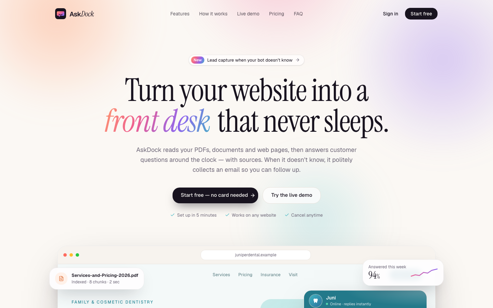

# AskDock — AI chatbots for small businesses

**Turn your website into a front desk that never sleeps.** AskDock learns a business's PDFs, Word documents and website, answers customers 24/7 **with cited sources**, collects an email when it doesn't know, and installs on any site with **one `<script>` tag**.

**Live demo:** [askdock.vercel.app](https://askdock.vercel.app) · no sign-up, no keys



> Demo project by **OVIOWEB**. "Juniper Dental Studio" and everything about it is fictional.

---

## Run the demo in 60 seconds

No accounts, API keys or `.env` file needed. With zero environment variables AskDock runs on an in-memory workspace seeded with **Juni**, the assistant for a fictional dental clinic.

```bash
git clone https://github.com/navjot110099/askdock.git
cd askdock
npm install
npm run dev
```

Then open http://localhost:3000 and:

1. **Ask Juni something** in the *Live demo* section — try "How much are clear aligners?" (cited answer) or "Do you treat sleep apnea?" (lead capture).
2. **Sign in** — demo mode opens the seeded workspace straight away, no password.
3. **Explore the dashboard**: upload [`samples/Cosmetic-Treatments-2026.pdf`](samples) on the bot's *Knowledge* tab, restyle it on *Customise*, copy the snippet from *Install*, then check *Conversations*, *Leads* and *Analytics*.
4. **See the widget on a website** at http://localhost:3000/widget-demo.
5. **Start over** any time with **Reset demo** in the purple *Demo mode* banner.

---

## How it works

1. **Add what you already have.** Upload price lists, policies and guides (PDF, DOCX, TXT, Markdown) or paste the website address. AskDock extracts the text, splits it into chunks and indexes them.
2. **Make it sound like you.** Name, avatar, brand colour, welcome message and suggested questions, previewed live.
3. **Paste one line.** A script tag adds a chat bubble to any site. Visitors get answers that cite the exact document or page; questions it can't answer become leads, and the dashboard shows what to add next.

Under the hood each answer is retrieval-augmented: the question is matched against the bot's chunks, the best excerpts are numbered in the prompt, and the model must answer only from them and cite `[n]` (details [below](#under-the-hood-the-rag-pipeline)).

---

## Features

| Area | What's included |
| --- | --- |
| **Landing page** | Animated hero with a scripted widget demo, how it works, features bento, a **live demo** chatting with the seeded dental bot, pricing (Free / Pro / Business), FAQ, final CTA |
| **Auth** | Supabase Auth with email + password, magic link and **Google OAuth** (server actions + `@supabase/ssr` cookies, middleware-protected dashboard) |
| **Create a bot** | Name, business, colour and avatar → then add knowledge: **upload PDF / DOCX / TXT / MD** or **crawl a website URL** (same-site BFS, robots.txt, SSRF protection, plan page limits) |
| **RAG pipeline** | Heading-aware chunking → **OpenAI `text-embedding-3-small`** → **Supabase pgvector** (HNSW, cosine) → `match_chunks` RPC → grounded prompt with numbered excerpts |
| **Chat** | **Vercel AI SDK** streaming (`streamText` + UI message stream), `[n]` **source citations** rendered as chips with an expandable sources list, follow-up aware retrieval, rate limiting |
| **Lead capture** | When the answer isn't in the knowledge base (or the visitor asks for a person), the model calls a `request_contact` tool → an inline email form appears → lead saved with the question and conversation |
| **Customise** | Name, preset or uploaded avatar, brand colour (presets + custom hex), welcome message, up to 4 suggested questions, extra instructions, lead-capture toggle — with a **live preview** |
| **Embeddable widget** | `public/widget.js`: Shadow-DOM bubble + lazy iframe, greeting pop-up, mobile full-screen, `data-position` / `data-greeting` options, `window.AskDock.open()` |
| **Dashboard** | Overview KPIs with period deltas, **messages per day** chart, **top questions**, knowledge gaps, busiest hours, conversations (filters, search, transcripts with citations), leads (status pipeline, CSV export) |
| **Billing** | **Stripe test mode**: Checkout, signed **webhook** → plan sync, **customer portal**, usage meters. **Plan limits enforced** server-side (bots, sources, crawl pages, file size, monthly messages, lead capture, branding, CSV export, analytics range) |
| **SEO** | Per-page titles, descriptions and canonical URLs, Open Graph + Twitter image, JSON-LD, `sitemap.xml`, `robots.txt`; dashboard, embed and sample pages are `noindex` |
| **Demo mode** | Zero-config in-memory workspace with a **Demo mode** badge and **Reset demo** button; 2 bots, 4 sources, ~2 months of realistic conversations, leads and a Pro subscription |

### Demo mode in detail

Whenever the Supabase keys are missing, AskDock runs on an **in-memory demo workspace** built from the same seed data as `npm run seed`:

- sign-in opens the seeded workspace, and every dashboard page shows a **Demo mode** badge with a **Reset demo** button that restores the seed,
- uploads and crawls really parse and chunk content (stored in memory),
- retrieval uses BM25 instead of pgvector, and without `OPENAI_API_KEY` answers are assembled extractively from the best-matching passages (still streamed, still cited, still triggering lead capture),
- plan switches on the billing page apply instantly instead of going through Stripe,
- data lives in server memory, so it also resets on restart (on Vercel, per serverless instance). Set `DEMO_SEED_NOW` to pin the seed's reference date when you need identical numbers, e.g. for screenshots.

Add the keys below and the exact same UI runs on Supabase, OpenAI and Stripe.

---

## Tech stack

Next.js 15 (App Router, Server Actions, Turbopack) · TypeScript · Tailwind CSS v4 · shadcn/ui (Radix) · Framer Motion · Vercel AI SDK v7 + `@ai-sdk/openai` · Supabase (Auth, Postgres, pgvector, Storage, RLS) · Stripe · Recharts · unpdf · mammoth · cheerio · zod · Playwright

---

## Full setup (live mode)

### 1. Supabase

1. Create a project at [supabase.com](https://supabase.com).
2. Run the migration in [`supabase/migrations/20261031000000_init.sql`](supabase/migrations/20261031000000_init.sql) — either `supabase db push` with the CLI or paste it into the SQL editor. It enables `pgvector`, creates the tables, triggers, RLS policies, the `match_chunks` function and the `bot-avatars` storage bucket.
3. **Auth → URL configuration**: set the Site URL to your app URL and add `http://localhost:3000/auth/callback` (and your production `/auth/callback`) to the redirect allow-list.
4. **Auth → Providers → Google**: enable it with a Google OAuth client (authorised redirect URI: `https://<project-ref>.supabase.co/auth/v1/callback`).
5. Copy the project URL, anon key and service-role key into `.env.local`.

### 2. OpenAI

Add `OPENAI_API_KEY`. Chat uses `OPENAI_CHAT_MODEL` (default `gpt-5.4-mini`); embeddings use `text-embedding-3-small` (1536 dimensions, matching the `vector(1536)` column).

### 3. Seed the demo bot

```bash
npm run seed
```

Creates `demo@askdock.app` (password from `SEED_DEMO_PASSWORD`, or a generated one printed once), the Juni and Aligner Concierge bots, embeds their knowledge into pgvector and inserts ~2 months of conversations and leads. It's idempotent. Keep `NEXT_PUBLIC_DEMO_BOT_ID` set to the printed bot id so the landing-page demo uses it.

### 4. Stripe (test mode)

1. In the Stripe dashboard (**test mode**), create two recurring monthly prices: **Pro $29** and **Business $99**. Put their `price_…` ids in `STRIPE_PRICE_PRO` / `STRIPE_PRICE_BUSINESS` and your `sk_test_…` key in `STRIPE_SECRET_KEY`. Live keys are rejected at startup.
2. Enable the **customer portal** (Settings → Billing → Customer portal) and allow plan switching between the two prices.
3. Forward webhooks locally:
   ```bash
   stripe listen --forward-to localhost:3000/api/stripe/webhook
   ```
   and put the printed `whsec_…` in `STRIPE_WEBHOOK_SECRET`. In production, add an endpoint for `checkout.session.completed` and `customer.subscription.created|updated|deleted`.
4. Pay with `4242 4242 4242 4242`, any future date, any CVC.

### 5. Deploy to Vercel

1. Push the repo and import it in Vercel (framework preset: Next.js). With no variables at all it deploys in demo mode.
2. For live mode, add the variables from `.env.example`. `NEXT_PUBLIC_APP_URL` is optional on Vercel: it falls back to the project's production domain.
3. Add the production `/auth/callback` URL in Supabase and the production webhook endpoint in Stripe.

Chat streams for up to 30 s and ingestion runs up to 60 s (`maxDuration` on the routes).

---

## Embedding the widget

Every bot's **Install** tab shows its snippet:

```html
<script src="https://YOUR-DOMAIN/widget.js" data-bot="BOT_ID" async></script>
```

Options: `data-position="left"`, `data-greeting="off"`. The bubble fetches public config from `/api/widget/:botId` (CORS-enabled) and opens `/embed/:botId` in an iframe (`frame-ancestors *` is set only for `/embed`). Try it on the sample site at `/widget-demo`.

## Plans & limits

| | Free | Pro | Business |
| --- | --- | --- | --- |
| Price | $0 | $29 / mo | $99 / mo |
| Bots | 1 | 3 | 10 |
| Visitor messages / month | 100 | 2,000 | 10,000 |
| Knowledge sources | 5 | 50 | 300 |
| Pages per crawl | 10 | 50 | 200 |
| Max file size | 5 MB | 15 MB | 25 MB |
| Lead capture & CSV export | — | ✓ | ✓ |
| Remove "Powered by AskDock" | — | ✓ | ✓ |
| Analytics history | 7 days | 30 days | 90 days |

Limits live in [`lib/plans.ts`](lib/plans.ts) and are enforced in server actions and API routes, not just the UI.

---

## Under the hood: the RAG pipeline

1. **Ingest** (`lib/rag/ingest.ts`): files are parsed with unpdf / mammoth, sites are crawled with cheerio; text is split by headings into ~1,100-character chunks with sentence overlap (`lib/rag/chunk.ts`), embedded in batches and stored in `chunks` with an HNSW index.
2. **Retrieve** (`app/api/chat/route.ts`): the visitor's question (plus the previous one for short follow-ups like "and for kids?") is embedded and matched with `match_chunks` (cosine similarity, per bot).
3. **Answer**: the excerpts are numbered in the system prompt; the model must answer only from them and cite `[n]`. Citations are streamed first as a `data-sources` part, the answer streams as text, and the `request_contact` tool emits a `data-lead` part that renders the email form.
4. **Record**: both messages are saved; a trigger maintains conversation counters and flags unanswered chats, which feed the analytics "knowledge gaps".

## Security notes

- Row Level Security on every table; dashboard queries run as the signed-in user, anonymous widget traffic goes through server routes with the service role.
- Crawler blocks private/loopback/link-local addresses (re-checked on every redirect) and caps page size, page count and time.
- Per-IP rate limits on chat and lead capture, zod validation on every input, CSV export neutralises spreadsheet formulas.
- Prompt instructs the model to ignore instructions embedded in documents or messages.
- `.env.example` holds empty placeholders only; real keys live in `.env.local` (git-ignored) or Vercel project settings. Live Stripe keys are refused at startup.

## Logging

App code logs through `lib/logger.ts` instead of `console` (ESLint's `no-console` rule enforces it). `debug` and `info` are silent in production; `warn` and `error` always reach the server logs so real failures are never swallowed.

## Scripts

| Command | What it does |
| --- | --- |
| `npm run dev` | Start the dev server |
| `npm run build` / `npm start` | Production build / server |
| `npm run seed` | Seed the demo workspace into Supabase |
| `npm run screenshots` | Capture every key screen at 1440×900 and 390×844 into `screenshots/` (start the app first; set `SCREENSHOT_BASE_URL` if not on :3000) |
| `npm run lint` / `npm run typecheck` | ESLint / TypeScript |
| `npx tsx portfolio/source/capture.ts` → `render.ts` | Rebuild the 10 portfolio slides in `portfolio/` (see the header of `capture.ts`) |

## Project structure

```
app/
  (marketing)/        landing page
  (auth)/             login, signup, auth server actions
  dashboard/          overview, bots (knowledge · customise · install), conversations, leads, analytics, billing
  embed/[botId]/      iframe chat used by the widget
  widget-demo/        sample customer website with the widget installed
  api/                chat (streaming RAG), sources (upload/crawl), leads, widget config, Stripe webhook
components/           chat window, marketing sections, dashboard UI, shadcn/ui
lib/
  rag/                chunking, extraction, crawler, embeddings, prompt, lexical search, offline responder
  db/                 repository interface + Supabase and in-memory demo implementations
  demo/               Juniper Dental knowledge base and deterministic seed generator
  plans.ts stripe.ts analytics.ts auth.ts env.ts logger.ts
public/widget.js      the embeddable chat bubble
supabase/migrations/  schema, pgvector, RLS, triggers
scripts/              seed + Playwright screenshots
samples/              sample PDF and DOCX for testing uploads
screenshots/          desktop/ and mobile/ captures
portfolio/            10 annotated portfolio slides + the scripts that build them
```

## Screenshots

All screens are in [`screenshots/desktop`](screenshots/desktop) (1440×900) and [`screenshots/mobile`](screenshots/mobile) (390×844 viewport, captured at 2× pixel density): landing sections, live demo answer, widget on a website, lead capture, login/signup, dashboard overview, bots, create bot, knowledge, customise, install, conversations, transcript, leads, analytics and billing.

---

Demo project by **OVIOWEB**.
